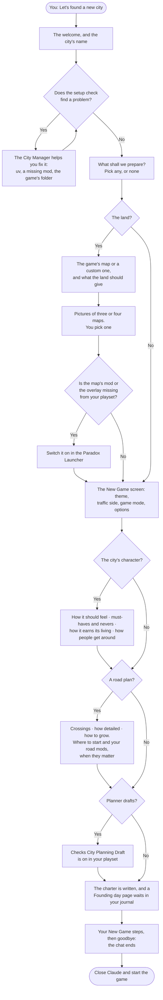
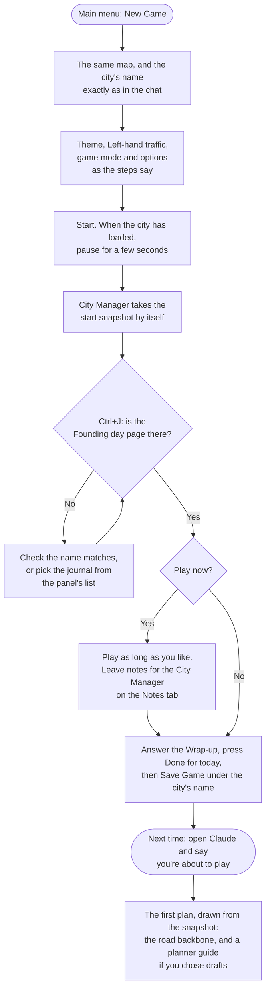

# Using City Manager

A walk-through: setting it up, founding a new city with the City Manager, starting that city in the game, and the
rhythm of play after that. The [README](../README.md) says what City Manager is and why it exists.

- [What you need](#what-you-need)
- [Setting it up](#setting-it-up)
- [Founding a new city](#founding-a-new-city)
- [After the founding: starting the city in the game](#after-the-founding-starting-the-city-in-the-game)
- [A city you already have](#a-city-you-already-have)
- [Every session after that](#every-session-after-that)
- [When something's off](#when-somethings-off)

## What you need

| | |
|---|---|
| **Cities: Skylines II** | With the **City Manager** mod and **City Planning Draft** (the build overlay) in your playset |
| **Claude Code** | The Claude desktop app's Code tab, or Claude Code in a terminal. It needs a paid Claude plan |
| **uv** | Runs the plugin's scripts. The setup check tells you if you need it |

Without Claude, the mod still works as an in-game notebook: Ctrl+J, start a journal, and write your own notes and
plans.

## Setting it up

1. **The mod.** Subscribe to [City Manager on Paradox Mods](https://mods.paradoxplaza.com/mods/169373/Windows) in the Paradox Launcher. City Planning Draft comes
   with it; make sure both are on in the playset you play with. Add mods in the launcher, never from inside the game.
   (To build it yourself instead: [DEVELOPING.md](DEVELOPING.md).)
2. **The plugin.** In Claude Code, type:

   ```
   /plugin install city-manager --marketplace mayorgergich/cs2-city-manager
   ```

   On Claude Code older than 2.1.275, use two lines: `/plugin marketplace add mayorgergich/cs2-city-manager`, then
   `/plugin install city-manager@cs2-city-manager`.
3. **uv,** if the setup check asks for it: on Windows `winget install astral-sh.uv`, elsewhere the one-line install on
   [docs.astral.sh/uv](https://docs.astral.sh/uv/).

Then pick one: [found a new city](#founding-a-new-city), or [set up a city you already have](#a-city-you-already-have).

## Founding a new city

**When:** before you press New Game. The game can be closed, or sitting at the main menu.

**How to start it:** open Claude Code and say *"Let's found a new city"* (or anything like it: *"I want to start a new
city"*). The City Manager takes it from there, like the opening of an old text adventure:

> *Welcome, Mayor, to the founding of your new city. I'll be your City Manager. First question… what's the name of
> our city?*

Every part after the name is optional, every question takes your own words or a note, and the chat ends before the
game starts: the City Manager never plays with you or asks you to come back mid-game.



What each part gives you:

| Part | You get | Skip it and… |
|---|---|---|
| **The land** | Three or four maps that fit what you want, with pictures and a line on each | You choose the map yourself; say which one so the plan fits it |
| **The New Game screen** (always) | The exact settings to pick, in the screen's own words | — |
| **The city's character** | A short charter: the city's feel, its must-haves and nevers, its economy and transport | The first plan stays general |
| **A road plan** | At your next check-in: a survey of the map and the main roads and highways, in phases | No road plan |
| **Planner drafts** | That plan drawn over your city in City Planning Draft | The plan stays in the chat and the journal (choosing drafts brings the road plan with it) |

## After the founding: starting the city in the game

Only the **city's name** links the journal to the city, so it must match exactly. Use the **same map and settings**
too: the plan is made for them. The founding chat's last message lists every step; it goes like this:



1. **New Game**, the map from the chat.
2. **City name**: exactly as in the chat, same spelling and capitals.
3. **Theme, traffic and options** as listed. Left-hand traffic matters most: the road plan's ramps depend on it.
4. **Start**, and once the city has loaded, **pause for a few seconds**. City Manager takes a snapshot of the new map
   by itself; that snapshot is what the first plan is drawn from.
5. **Ctrl+J** (or the cones button at the top left): the **Founding day** page is on the Today tab.
6. **Play, or don't.** Tonight can be just a look around. Anything you notice, like where you'd want the old town,
   goes on the **Notes** tab.
7. Before you quit: answer the **Wrap-up**, press **Done for today**, then **Save Game** under the city's name.

The next time you check in, the City Manager reads the snapshot and draws the first plan from your founding answers.
With planner drafts, it also writes a guide: in game, open City Planning Draft and press **Import latest file**.

## A city you already have

Load the city once with the mod on, then tell Claude *"Set up City Manager for my city"*. It checks your setup, asks
your city's name exactly as the game shows it, asks a few questions about how you like to play, and makes the journal.
If you already started a journal in game (the panel's *Start a new journal for this city*), it keeps it, notes and
all. Take a snapshot on the panel's **City** tab, and your first report starts from it.

## Every session after that

| When | You | The City Manager |
|---|---|---|
| **Before you play** | Tell Claude you're about to play (*"prep me"*). Say how long you've got, if you like | Writes tonight's briefing: 3 to 7 tasks, your projects' next steps, at most two decisions |
| **While you play** | Close Claude. Ctrl+J for the journal: tick tasks, change a project's status, write notes | Nothing: no AI runs while you play |
| **After you play** | Answer the Wrap-up, press Done for today, save. Then tell Claude you've just played | Reads your ticks, notes and the city's snapshot, writes the report, answers every note, and writes the next briefing |

## When something's off

| What you see | What to do |
|---|---|
| The panel says no journal is linked | The city's name doesn't match the journal's. Pick the journal from the panel's list, or rename the city in game to the name from the chat |
| The custom map isn't on the New Game screen | Its mod isn't on in the active playset: switch it on in the Paradox Launcher, then restart the game |
| The setup check says uv or Pillow is missing | Install uv (above). If Python and Pillow are already installed, the check says the scripts can run without it |
| The City tab shows no snapshot | Press **Take a snapshot** on the City tab. Done for today and every save take one too |
| Claude talks about the wrong city | Name the city you mean, or ask it to make that city the active one |
| A guide didn't appear in the planner | In City Planning Draft, press **Import latest file**. The planner must have been opened once in that city |

Questions and bugs: the [Discord](https://discord.gg/Rtea83Gnb9) or a GitHub issue.
