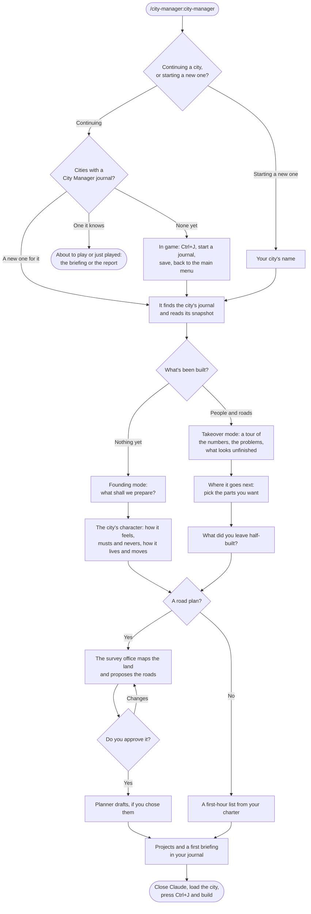

# Using City Manager

A walk-through: setting it up, founding a new city with the City Manager, starting that city in the game, and the
rhythm of play after that. The [README](../README.md) says what City Manager is and why it exists.

- [What you need](#what-you-need)
- [Setting it up](#setting-it-up)
- [Talking to the City Manager](#talking-to-the-city-manager)
- [Your first conversation](#your-first-conversation)
- [Every session after that](#every-session-after-that)
- [When something's off](#when-somethings-off)

## What you need

| | |
|---|---|
| **Cities: Skylines II** | With the **City Manager** mod and **City Planning Draft** (the build overlay) in your playset |
| **Claude Code** | The Claude desktop app's Code tab, or Claude Code in a terminal. It needs a paid Claude plan |
| **uv** | Runs the plugin's scripts. The setup check tells you if you need it |

Without Claude, the mod still works as an in-game notebook: Ctrl+J, start a journal, and write your own notes and
plans.

## Setting it up

1. **The mod.** Subscribe to [City Manager on Paradox Mods](https://mods.paradoxplaza.com/mods/169373/Windows) in the Paradox Launcher. City Planning Draft comes
   with it; make sure both are on in the playset you play with. Add mods in the launcher, never from inside the game.
   (To build it yourself instead: [DEVELOPING.md](DEVELOPING.md).)
2. **The plugin.**
   - **In the Claude desktop app** (Code tab): open the plugins menu (**+** next to the prompt box), then **Add** →
   **Add marketplace** → **Add from a repository**, paste the full address `https://github.com/mayorgergich/cs2-city-manager`, press **Sync**, and
   install **city-manager**.
   - **In Claude Code in a terminal:** type `/plugin install city-manager --marketplace mayorgergich/cs2-city-manager`
     (Claude Code 2.1.275 or later; on older versions, `/plugin marketplace add mayorgergich/cs2-city-manager`, then
     `/plugin install city-manager@cs2-city-manager`).

   If it asks where to install, choose **for you** (your user account): then the plugin works whichever folder you
   open Claude Code in. Updates don't come by themselves: in a terminal, `/plugin update city-manager@cs2-city-manager`; in
   the desktop app, from the plugins menu (not tried yet: if you find how, tell us on Discord).
3. **uv,** if the setup check asks for it: on Windows `winget install astral-sh.uv`, elsewhere the one-line install on
   [docs.astral.sh/uv](https://docs.astral.sh/uv/).

Then [your first conversation](#your-first-conversation), the same for a new city and one you already have.

## Talking to the City Manager

**Where:** Claude Code can run in any folder, but use the same one every time. Claude Code asks before it runs a
script or changes a file, and when you answer "don't ask again", it remembers that for the folder you're in. A good
folder is your City Manager folder, which the setup makes: `%LOCALAPPDATA%\CityManager` on Windows,
`~/.local/share/city-manager` on Linux. In the Claude desktop app, pick it with the folder button next to the prompt
box; in a terminal, `cd` there and run `claude`.

**How:** type **`/city-manager:city-manager`**. Your City Manager welcomes you and asks what's next: continuing work on a city
(then: about to play, or just played?) or starting a new one. Words after the command are shortcuts that skip the
question:

| Shortcut | Does |
|---|---|
| `/city-manager:city-manager prep me` | Tonight's briefing (add how long you've got, if you like) |
| `/city-manager:city-manager report` | The report on the session you just played, and the next briefing |
| `/city-manager:city-manager` and a question | An answer: *where are we with Main Street?* |

Plain words often work too, because Claude picks the City Manager from what you ask, but the command always reaches it.

## Your first conversation

One conversation sets City Manager up for a city, new or old. Your City Manager looks at what you've built and either
**founds** the city properly or **takes it over**, and both end with projects and a first briefing in your journal
(and planner drafts, if you want them).

**1. In the game first: start a journal.** This is required. The City Manager reads your city from a snapshot the
mod takes, and the mod takes the first one as soon as the journal starts.
1. Make a new city (New Game, any map and settings), or load one you already have.
2. Press **Ctrl+J** (or the cones button at the top left), then *Start a new journal for this city*. That takes the
   first snapshot. (After that, *Done for today* and every save take a new one, and so does **Take a snapshot** on the
   journal's **City** tab.)
3. Save, and go back to the main menu (or quit). Claude never runs while you play; the main menu isn't playing.

**2. Then in Claude Code,** type `/city-manager:city-manager`. It opens in character, like the start of an old text adventure, and
asks one thing: *are we continuing work on a city, or starting a new one?*
- **Starting a new one:** it asks the city's name, finds its journal, and founds it properly.
- **Continuing:** it lists your cities with a City Manager journal. A city it hasn't met yet gets taken over; one it
  knows goes straight to tonight's briefing or the report. No journal anywhere yet? It asks whether you're setting it
  up in a city you already have, and walks you through starting one.

Either way, it says what it sees (*"Napster is brand new: the highways are in, nothing else yet."*) and you agree the
mode together:

| What it finds | Mode | What you get |
|---|---|---|
| Nothing built yet | **Founding** | A charter (what the city should feel like, how it lives and moves, must-haves and nevers), then the survey office maps the land and proposes the first roads, drawn as planner drafts if you like |
| A city with people and roads | **Takeover** | A tour of what's there (the numbers, the problems by street, what looks unfinished), where it goes next, and your half-built plans turned into projects |
| Either, if you'd rather | **Just the journal** | The notebook and the session rhythm, with a charter any time later |

Every part is optional, and every question takes your own words or a note.

**With planner drafts:** in game, open City Planning Draft and press **Import latest file**; build from the **Now**
plans, which match the first briefing's steps.

**No city made yet?** Choose *starting a new one* and say you haven't made it. The founding then starts before New
Game: maps that fit what
you want, with pictures, the New Game settings in the screen's own words, and your city's character. Then you make the
city (the chat gives the exact steps: the name must match). Once it loads, the journal waiting under its name links by
itself and takes the first snapshot a few seconds later (press **Ctrl+J** to see it). Save, go back to the main menu,
and tell the chat. The road plan and the drafts follow, as above.

## Every session after that

| When | You | The City Manager |
|---|---|---|
| **Before you load your city** | `/city-manager:city-manager prep me`. Say how long you've got, if you like | Writes tonight's briefing: 3 to 7 tasks, your projects' next steps, at most two decisions |
| **In the game** | Close Claude. Ctrl+J for the journal: tick tasks, change a project's status, write notes | Nothing: no AI runs while you play |
| **When you're done** | Answer the Wrap-up, press Done for today, save. Then `/city-manager:city-manager report` | Reads your ticks, notes and the city's snapshot, writes the report, answers every note, and writes the next briefing |

## When something's off

| What you see | What to do |
|---|---|
| The panel says no journal is linked | Press *Start a new journal for this city*, or pick yours from the panel's list. A journal made in the chat before the city existed waits under the exact name you gave |
| The custom map isn't on the New Game screen | Its mod isn't on in the active playset: switch it on in the Paradox Launcher, then restart the game |
| The setup check says uv or Pillow is missing | Install uv (above). If Python and Pillow are already installed, the check says the scripts can run without it |
| The City tab shows no snapshot | Press **Take a snapshot** on the City tab. Done for today and every save take one too |
| The City Manager says it can't read your city | It needs a journal: load the city, press **Ctrl+J** and *Start a new journal for this city* if there's none (that takes the first snapshot), save, then ask again |
| Claude talks about the wrong city | Name the city you mean, or ask it to make that city the active one |
| A guide didn't appear in the planner | In City Planning Draft, press **Import latest file**: it loads the newest guide for this city |

Questions and bugs: the [Discord](https://discord.gg/Rtea83Gnb9) or a GitHub issue.
